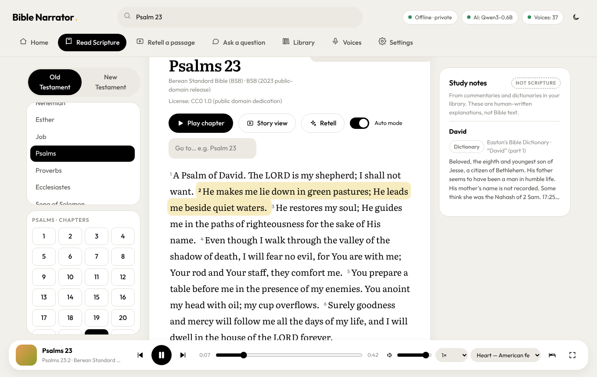
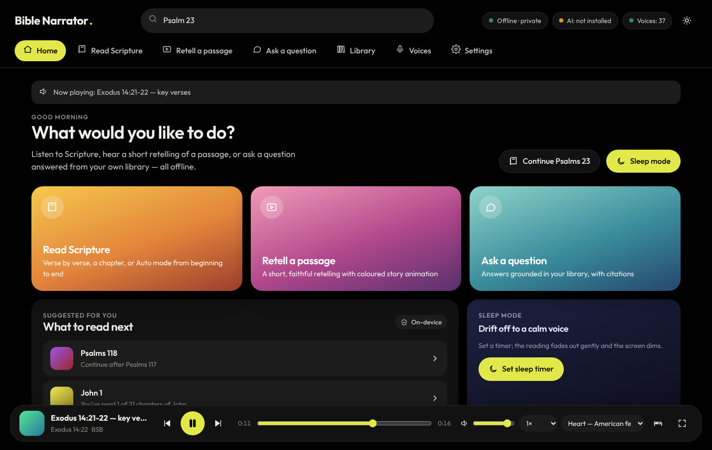
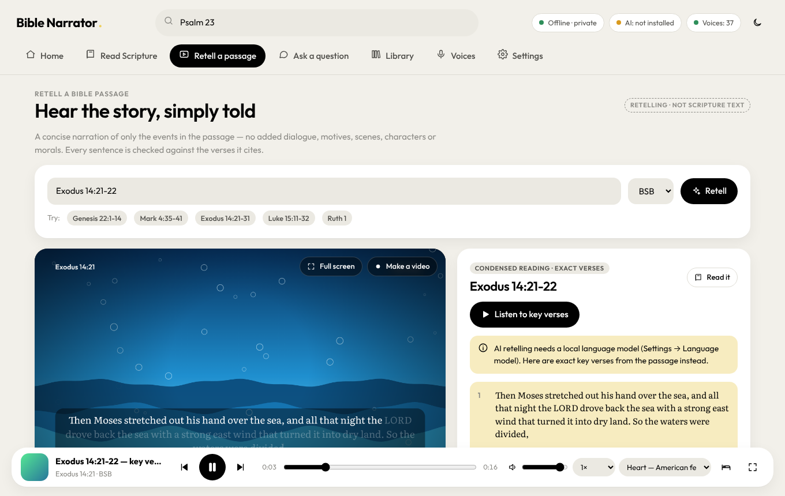
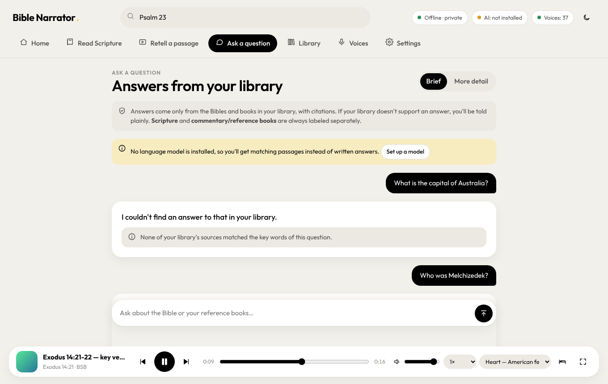

# Bible Narrator

A private desktop app for **listening to Scripture**, hearing **short, faithful retellings** of Bible passages, and **asking questions answered only from your own library**, with citations. Reading, narration, search, retelling and answers all run on your computer, and nothing you type or import is sent anywhere.

| Light mode | Black mode |
|---|---|
|  |  |
|  |  |

## What it does

**Three clearly labeled modes**

1. **Read Scripture**: the selected Bible text, verbatim, with the translation, edition, license and verse numbers on screen. You can click any verse to start there, play a whole chapter, or turn on **Auto mode** to keep reading chapter after chapter through to Revelation. The verse being read is highlighted and stays in view.
2. **Retell a passage**: a concise narration of only the events in the cited verses. Every sentence lists the verses it retells and is checked before it is shown or spoken (see [Honesty](#honesty-how-answers-are-kept-grounded)). You can type a reference (`Mark 4:35-41`) or describe an event ("Jesus calms the storm"). For an event, the app suggests matching passages for you to pick first.
3. **Ask a question**: a brief answer by default, or **More detail** on request, built only from passages retrieved from your library. Each statement carries numbered citations (book, chapter, verse, translation, source title). If the library doesn't support an answer, the app says exactly: *"I couldn't find an answer to that in your library."*

**Listening**
- 37 local voices. **27 natural voices** (Kokoro-82M: US and UK English, female and male) and **10 basic voices** (eSpeak NG) that work right after install. Automated tests check that every voice produces measurably different audio.
- Preview any voice, save a default, and switch voices before or during playback.
- Player with play/pause, previous and next verse, seek across the whole passage, speed from 0.75× to 2×, and volume. Keyboard: Space plays or pauses, ←/→ move between verses, Shift+←/→ jump 10 seconds. Media keys work too.
- **Story view**: a full-screen, coloured animated scene with word-by-word captions synced to the narration. **Make a video** saves the narration and animation as a 1280×720 WebM file in `Downloads/Bible Narrator`. The visuals are abstract (sky, water, light, hills, particles), and colours and motifs are chosen only from words in the text being read ("sea", "night", "fire"…). They never depict people or invent scenes, and the screen says so.
- **Sleep mode**: a timer (15–90 minutes, or end of chapter) that gently fades the voice out, plus a dim, minimal screen.
- **Suggestions**: "What to read next" comes from a small on-device recommender. It continues where you left off, offers to finish books you started, and suggests chapters that share themes with what you spend time on (TF-IDF similarity). History is stored only locally, and you can turn it off (which also clears it) in Settings.

**Library**
- Bundled public-domain texts (no download needed): **Berean Standard Bible** (CC0), **King James Version**, **American Standard Version**, and **Easton's Bible Dictionary**.
- You can add Bibles, commentaries, dictionaries and other books you have the right to use. Each source keeps its title, type, translation or edition, license, attribution and origin. Locations are preserved as verses, pages (`p. 12`), articles (`"Aaron"`) or sections.
- Scripture and reference books are always shown differently: a gold **Scripture** chip versus a dashed **Not Scripture** label. Commentary is never presented as Bible text, and an answer drawn only from reference books says so.

**Privacy**: there are no accounts, analytics, telemetry or cloud AI. The local server listens on `127.0.0.1` only and needs a random per-launch token. The only internet use is a model or voice download that you start by clicking **Download**, and you can avoid even that by choosing files you already have.

## Quick start (from source)

Requirements: Python 3.10–3.13 and a C/C++ compiler (llama.cpp is built during install if no prebuilt wheel exists for your system).

```bash
cd bible-narrator
```

```bash
python -m venv .venv
```

Activate the environment (`.venv\Scripts\activate` on Windows):

```bash
source .venv/bin/activate
```

```bash
pip install -r requirements.txt
```

```bash
python -m bible_narrator
```

The app opens in its own window. Useful options:

| Command | What it does |
|---|---|
| `python -m bible_narrator --browser` | Use your web browser instead of a desktop window (still 100% local). |
| `python -m bible_narrator --data-dir D:\BibleData` | Keep the library, settings and models in a specific folder. |
| `python -m bible_narrator --server --port 8765 --token dev` | Run headless, e.g. for automated tests. |

**Desktop window prerequisites**
- **Windows**: Microsoft Edge WebView2 runtime (preinstalled on Windows 10/11).
- **macOS**: nothing extra (uses WKWebView).
- **Linux**: install a WebKitGTK or Qt WebEngine binding, e.g. `sudo apt install python3-gi gir1.2-webkit2-4.1`, or `pip install "pywebview[qt]"`. Without one, the app opens in your browser instead.

On first launch, a short welcome guide walks you through the library, voices and the optional language model.

## Setting up voices and the language model

Everything except the files below is included. Both downloads are optional, and the app tells you clearly what needs them.

### Natural voices: Kokoro-82M (about 100 MB, Apache-2.0)
- **In the app**: open Voices and click **Download**, or
- **Manually**: download `onnx/model_quantized.onnx` and the `voices/*.bin` files you want from <https://huggingface.co/onnx-community/Kokoro-82M-v1.0-ONNX>, put them in one folder, then choose that folder in Voices (**Choose folder…**). A `voices-v1.0.bin` voice pack from the `kokoro-onnx` releases also works.
- **Command line**: `python scripts/fetch_models.py kokoro-82m-q8`

Until then, the 10 basic eSpeak NG voices work offline.

### Language model (needed for Retell and Ask)
Any instruction-tuned **GGUF** model works. The app offers these Apache-2.0 open-weight models:

| Model | Size | Notes |
|---|---|---|
| Qwen3 4B (Q4_K_M), **recommended** | 2.5 GB | Best balance of accuracy and speed; ~4 GB free RAM |
| Qwen2.5 1.5B Instruct (Q4_K_M) | 1.1 GB | For older computers; less reliable |
| Qwen3 0.6B (Q4_K_M) | 0.4 GB | Testing only; many answers will be withheld |

- **In the app**: Settings → Language model → **Download**, or **Choose file…** for a `.gguf` you already have.
- **Command line**: `python scripts/fetch_models.py qwen3-4b-q4km`
- **Advanced**: point the app at a model server already running on this computer (Ollama, LM Studio, llama.cpp server). Only `localhost`/`127.0.0.1` addresses are accepted.

Without a model, Read Scripture, narration, search, study notes, Story view and Sleep mode all work. Retell shows a labeled **condensed reading** of exact key verses, and Ask shows matching passages, clearly marked *"Search results — not an answer"*.

> **GPU acceleration (optional):** reinstall llama.cpp with your GPU backend, e.g. `CMAKE_ARGS="-DGGML_METAL=on" pip install --force-reinstall --no-cache-dir llama-cpp-python` (macOS) or `-DGGML_CUDA=on` (NVIDIA).

## Adding Bibles and books

Go to Library → **Add a Bible or book**, choose what it is (Bible, Commentary, Bible dictionary, Other book), pick the file, fill in the title, edition and license, and confirm you have the right to use it.

| Kind | Formats |
|---|---|
| Bible (Scripture) | USFM (`.usfm`, or a `.zip` of USFM files such as eBible.org downloads), OSIS XML, Zefania XML, JSON (Scrollmapper-style or verse records), CSV/TSV (`book,chapter,verse,text`), verse-per-line text (`Gen 1:1 In the beginning…`) |
| Commentary / dictionary / other | PDF (page numbers kept), EPUB, HTML, text or Markdown (headings become sections), JSON/CSV dictionaries (`term,text`), verse-keyed commentary CSV/JSON (`book,chapter,verse_start,verse_end,text`). Verse-keyed commentary appears beside the passage in Read Scripture. |

Good public-domain or openly licensed sources include eBible.org (e.g. the World English Bible in USFM), CrossWire/SWORD exports converted to OSIS, CCEL texts (e.g. Matthew Henry's Commentary), and Project Gutenberg. Scanned PDFs without a text layer can't be imported (no OCR). The 66-book Protestant canon is supported; deuterocanonical books are skipped with a notice.

## Honesty: how answers are kept grounded

The language model is used only to *phrase* what your library says. It is never trusted on its own:

1. **Local retrieval (RAG)**: SQLite FTS5/BM25 search over all enabled Bibles and reference books. References in the question (e.g. "John 3:16") are fetched directly.
2. **Gate**: if the question's key words, especially names, aren't in your library at all, the app answers "I couldn't find an answer to that in your library." without calling the model.
3. **Constrained generation**: the model gets numbered sources labeled SCRIPTURE or COMMENTARY/DICTIONARY/REFERENCE (not Scripture), and must reply in JSON with a status: answered, partial, not in sources, or sources disagree.
4. **Sentence-by-sentence checks** against the cited text. A sentence is removed if:
   - its wording isn't supported by the cited text,
   - it names people or places that aren't there,
   - it puts words in quotation marks that don't appear verbatim,
   - it cites a reference outside the sources, or
   - (in a retelling) it adds a moral or lesson.
   A wrong citation number is corrected only if another retrieved source fully supports the sentence.
5. **Verification pass**: the model then judges each remaining sentence against only the text it cites, and anything it can't confirm is withheld.
6. **Transparency**: removed statements are listed under "withheld by the accuracy checks". If nothing survives, you get the plain "couldn't find" message. Partial answers and disagreeing sources are labeled, and so are answers that rest only on reference books.

Retellings follow the same rules. If a retelling fails the checks twice, the app shows exact key verses instead, labeled **Condensed reading · exact verses**.

Fine-tuning or a LoRA adapter is optional and not used. Correctness comes from retrieval plus verification, not from the model's memory.

**Known limits.** The checks are lexical plus model self-verification. They reliably catch invented names, quotes, citations and morals, but can't guarantee that every paraphrase is a perfect reading of the source, so citations are always shown for you to check. Small models (such as the 0.6B test model) often produce answers that get withheld. Use the recommended 4B model for useful results.

## Building an installer

Install the build tools, then build the app folder with PyInstaller on each target OS (cross-compiling isn't supported):

```bash
pip install -r requirements.txt pyinstaller
```

```bash
pyinstaller packaging/bible_narrator.spec --noconfirm
```

This creates `dist/BibleNarrator/` (on macOS, `dist/BibleNarrator.app`). Then wrap it for your platform:

- **Windows**: install [Inno Setup 6](https://jrsoftware.org/isinfo.php), then run `iscc packaging\windows\installer.iss`. This produces `dist\BibleNarrator-Setup-1.0.0.exe` with Start-menu and optional desktop shortcuts.
- **macOS**: optionally convert `packaging/icon.png` to `packaging/icon.icns` with `iconutil` before building, then create a disk image with `hdiutil create -volname "Bible Narrator" -srcfolder dist/BibleNarrator.app -ov -format UDZO dist/BibleNarrator.dmg`. Sign and notarize with your Apple Developer ID if you distribute it.
- **Linux**: ship `dist/BibleNarrator/` as a tarball, or build an AppImage with [appimagetool](https://github.com/AppImage/appimagetool). Copy the folder into `AppDir/usr/bin/`, and add `packaging/linux/bible-narrator.desktop` and `packaging/icon.png` (as `bible-narrator.png`).

Model and voice files are **not** bundled, which keeps installers small (~200 MB unpacked) and lets each user accept each model's license. They are downloaded or chosen on first run. To make an offline-ready installer for a computer with no internet, copy the files into the data folder (see below), or ship them alongside the installer and choose them during onboarding.

The Linux build was tested: the packaged binary started, installed the bundled library, synthesized speech with both voice engines, and loaded a GGUF model. The Windows and macOS scripts are provided but were **not** built or tested in this environment.

## Where things are stored

`%LOCALAPPDATA%\BibleNarrator` (Windows), `~/Library/Application Support/BibleNarrator` (macOS), `~/.local/share/BibleNarrator` (Linux):
`library.sqlite3` (your library and reading history), `settings.json`, `models/`, `voices/kokoro/`, `cache/audio/` (safe to delete). Exported videos go to `Downloads/Bible Narrator/`.

## Development

```bash
pip install pytest
```

```bash
python -m pytest
```

The tests cover reference parsing, every importer, the grounding rules (using a scripted stand-in for the model), the API's security guards, the recommender, and that all 10 basic voices produce distinct audio. To also test that the natural voices are distinct, run with `KOKORO_DIR=/path/to/kokoro`.

To rebuild the bundled starter texts, see `scripts/build_starter_content.py`.

Code map (`bible_narrator/`): `books.py` (canon and reference parser), `importers.py`, `library.py`, `retrieval.py` (FTS5 RAG), `grounding.py` (checks), `answer.py` (Ask), `retell.py` (Retell), `llm.py` (llama.cpp and local-server backends), `tts.py` (Kokoro and eSpeak NG), `recommend.py`, `downloads.py`, `server.py` (local API), `__main__.py` (desktop launcher), `web/` (UI: plain HTML/CSS/JS, no build step).

## Licenses

The app code is MIT (see `LICENSE`). Bundled content, voices, models and fonts each keep their own licenses. See [docs/LICENSES.md](docs/LICENSES.md). Binary installers include eSpeak NG (GPL-3.0), so distributed installers must also follow the GPL-3.0 (the MIT code is GPL-compatible, and the source is this repository).
